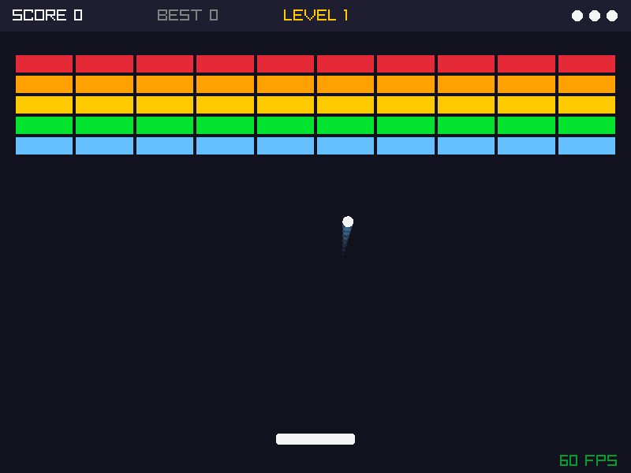

# Brickfall (C++ / raylib)

A Breakout-style arcade game written in **C++17** with the **raylib** graphics library and built with **CMake**.



## Features

- Paddle aiming: where the ball hits the paddle sets its bounce angle
- Levels that keep going. Each one adds rows, adds 2-hit bricks and speeds up the ball
- Score, 3 lives, and a high score saved to a file between runs
- Particle effects when bricks break, plus a motion trail on the ball
- A game state machine: Title → Playing ⇄ Paused → Level Complete → Game Over
- Frame-rate-independent movement (delta time) with a capped timestep so the physics stay stable

## Controls

| Key | Action |
|---|---|
| ← / → or A / D | Move the paddle |
| Space | Start the game / launch the ball |
| P | Pause or resume |
| Esc | Quit |

## Building

You need a C++17 compiler, CMake 3.16 or newer, and git. The first time CMake configures the project, it **downloads raylib automatically**, so there's nothing else to install.

### Qt Creator
1. **File → Open File or Project…** and choose `CMakeLists.txt`.
2. Pick a kit (the default desktop one) and click **Configure Project**. The first configure takes about a minute while it downloads raylib.
3. Click the green **Run** ▶ button.

### Command line
```bash
cmake -S . -B build -DCMAKE_BUILD_TYPE=Release
cmake --build build
./build/brickfall
```

> **macOS:** if you get a compiler or git error, run `xcode-select --install` once.

## Code layout

```
src/
  main.cpp     Window setup and the game loop (update → draw, every frame)
  Config.h     All the gameplay tuning constants in one place
  Game.h/.cpp  State machine, level generation, collisions, scoring, particles, HUD
  Paddle.h/.cpp  Player input and movement
  Ball.h/.cpp    Movement, wall bounces, brick bounces, and the trail effect
```

## How the collisions work

- **Ball vs. paddle:** the hit position is scaled to −1 (left edge) through +1 (right edge), then multiplied by a 60° max angle. The new velocity is `(speed·sin θ, −speed·cos θ)`, so the speed stays the same and only the direction changes.
- **Ball vs. brick:** the code measures how far the ball overlaps the brick from each side. The side with the smallest overlap is the side that was hit, so the ball is pushed out on that axis and its velocity is flipped.
- Velocities are *set* to a direction (not just negated) so the ball can't get stuck jittering inside a wall.
